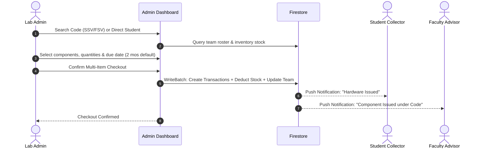
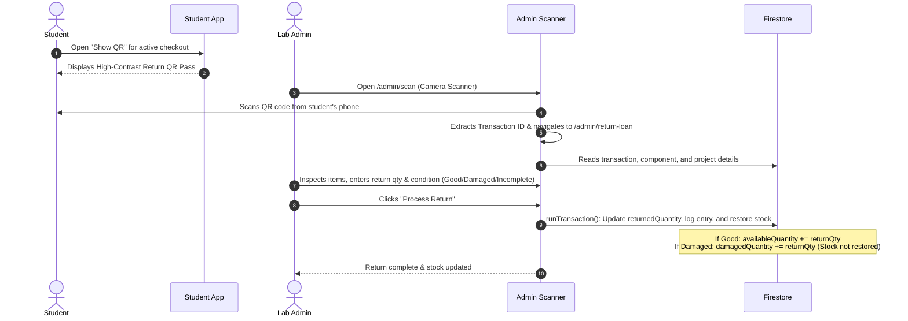

# Vinner Lab (LabSlot) — Comprehensive Project Knowledge Base

> **System Overview:** Vinner Lab is an enterprise-grade Laboratory Inventory & Component Checkout Management Platform engineered specifically for institutional hardware labs (such as university maker spaces, innovation cells, and electronics laboratories). It provides real-time stock tracking, project-code-linked multi-item hardware loans, student & faculty role management, automated due date reminders, and QR-code-driven checkout and return operations.

---

## Table of Contents
1. [Project Overview & Key Objectives](#1-project-overview--key-objectives)
2. [Technology Stack & Architectural Architecture](#2-technology-stack--architectural-architecture)
3. [Firestore Database Schema & Security Models](#3-firestore-database-schema--security-models)
4. [Identification, Naming & Coding Conventions](#4-identification-naming--coding-conventions)
5. [Core Business Logic & Service Architecture](#5-core-business-logic--service-architecture)
6. [Application Routes & Page Workflows](#6-application-routes--page-workflows)
7. [User Roles & Access Control Matrix](#7-user-roles--access-control-matrix)
8. [Hardware Issuance & Return Mechanics](#8-hardware-issuance--return-mechanics)
9. [Automated Due-Date & Overdue Notification System](#9-automated-due-date--overdue-notification-system)
10. [Repository Directory & File Structure](#10-repository-directory--file-structure)
11. [Setup, Environment Variables & Deployment](#11-setup-environment-variables--deployment)
12. [Gotchas, Edge Cases & Architectural Best Practices](#12-gotchas-edge-cases--architectural-best-practices)

---

## 1. Project Overview & Key Objectives

In academic and research hardware laboratories, hardware components (microcontrollers, sensors, communication modules, development boards) frequently go missing, suffer unaccounted damage, or remain unreturned for semesters. 

**Vinner Lab** solves these challenges through:
- **Verified Team & Faculty Governance**: Every major hardware checkout is bound to a validated academic project code (SSV/FSV) supervised by verified faculty advisors and student teammates.
- **Direct Student Checkouts**: Supports direct student checkouts for non-project/individual work.
- **Multi-Item Batch Issuance**: Allows administrators to check out multiple diverse components in a single atomic database transaction.
- **Physical QR Return Passes**: Generates high-contrast QR codes on the student's device that lab admins scan using integrated camera scanners for touchless, instant returns.
- **Defect & Damage Segregation**: Granular return conditions (`Good`, `Damaged`, `Incomplete`). Damaged units are isolated from available inventory to avoid reissuing faulty hardware.
- **Proactive Notification Engine**: Monitors return due dates and dispatches warnings (7 days prior) and overdue alerts to students and faculty without spamming duplicates.
- **Progressive Web App (PWA)**: Installable on Android, iOS, Windows, and macOS with native app feel.

---

## 2. Technology Stack & Architectural Architecture

### Frontend Layer
- **Framework**: [React 19](https://react.dev/) (`19.2.8`) with [React DOM](https://react.dev/) (`19.2.8`)
- **Language**: [TypeScript](https://www.typescriptlang.org/) (`~6.0.2`) in strict module mode
- **Bundler & Build Tool**: [Vite 8](https://vitejs.dev/) (`8.3.0`) using `@vitejs/plugin-react`
- **Routing**: [React Router DOM v7](https://reactrouter.com/) (`7.18.4`)
- **Styling**: [Tailwind CSS v3](https://tailwindcss.com/) (`3.4.19`), PostCSS, Autoprefixer, custom dot-grid backgrounds, and glassmorphism styling
- **Icons**: [Lucide React](https://lucide.dev/) (`1.55.0`)
- **Utility Libraries**: `clsx` (`2.1.1`) and `tailwind-merge` (`3.7.0`) via unified `cn()` utility

### QR Code & Hardware Scanning
- **QR Generation**: [qrcode](https://www.npmjs.com/package/qrcode) (`1.5.4`) with High Error Correction (`Level H`)
- **Camera QR Scanner**: [html5-qrcode](https://www.npmjs.com/package/html5-qrcode) (`2.3.8`) with rear-camera default and dynamic viewport bounding boxes

### Backend & Cloud Infrastructure (Firebase)
- **SDK**: [Firebase JS SDK v13](https://firebase.google.com/docs) (`13.0.0`)
- **Authentication**: Firebase Authentication (Email/Password authentication provider)
- **Database**: Cloud Firestore (Real-time NoSQL document store)
- **Hosting**: Firebase Hosting with single-page application (SPA) rewrite rules
- **Security Rules**: Declarative Firestore Security Rules enforcing role-based access

### Progressive Web App (PWA)
- **Plugin**: `vite-plugin-pwa` (`2.0.0`)
- **Service Worker**: Auto-update registration mode (`autoUpdate`)
- **Display**: Standalone display configuration with responsive app icons (192x192, 512x512 maskable)

---

## 3. Firestore Database Schema & Security Models

### 3.1 Collections Overview

```
Firestore Root
├── users/                # User accounts (Students, Faculty, Admins)
├── inventory/            # Hardware component catalog & stock levels
├── project_codes/        # Supervised project teams (SSV & FSV codes)
├── transactions/         # Component loan records & checkouts
└── notifications/        # User-targeted alerts and reminders
```

---

### 3.2 Collection Schemas

#### 1. `users` Collection
- **Document ID**: Firebase Auth `uid` (string)
- **Fields**:
  | Field | Type | Description |
  |---|---|---|
  | `uid` | `string` | Unique Firebase Auth UID |
  | `name` | `string` | Full name of the user |
  | `email` | `string` | User email (students must end with `@vitstudent.ac.in`) |
  | `regNumber` | `string` | Uppercase Student Registration Number or Faculty Employee ID |
  | `mobileNumber` | `string` | Exactly 10-digit mobile phone number |
  | `role` | `'student' \| 'faculty' \| 'admin'` | Access level in the application |
  | `studentCode` | `string?` | Auto-generated unique student code (e.g., `IIC2026-27-0001`) |
  | `academicYear` | `string?` | Academic year at time of registration (e.g., `2026-27`) |
  | `createdAt` | `timestamp` | Registration timestamp |

#### 2. `inventory` Collection
- **Document ID**: Auto-generated Firestore ID or slug (string)
- **Fields**:
  | Field | Type | Description |
  |---|---|---|
  | `id` | `string` | Document ID |
  | `name` | `string` | Component name (e.g., "ESP32 DevKit V1", "Arduino Uno") |
  | `category` | `string` | Category (`Microcontrollers`, `Sensors`, `Modules`, `SBC`, etc.) |
  | `description` | `string` | Detailed technical specifications, pinout, or notes |
  | `totalQuantity` | `number` | Total units ever cataloged in the laboratory |
  | `availableQuantity`| `number` | Units currently on the shelf ready for checkout |
  | `issuedQuantity` | `number` | Units currently checked out to students |
  | `damagedQuantity` | `number?` | Units returned damaged/incomplete (segregated from stock) |
  | `lowStockThreshold`| `number` | Alert threshold triggering low stock warnings (default: 2) |
  | `storageLocation` | `string?` | Shelf / bin location inside the lab |
  | `imageUrl` | `string?` | Optional component photo URL |
  | `isArchived` | `boolean` | Soft-deletion flag (hidden from active listings if `true`) |
  | `createdAt` | `timestamp` | Creation timestamp |
  | `updatedAt` | `timestamp` | Last inventory adjustment timestamp |

#### 3. `project_codes` Collection
- **Document ID**: The project code string itself (e.g., `SSV2026-27-0001` or `FSV2026-27-0001`)
- **Fields**:
  | Field | Type | Description |
  |---|---|---|
  | `id` | `string` | Matches code (e.g. `SSV2026-27-0001`) |
  | `code` | `string` | Uppercase formatted project code |
  | `codeType` | `'SSV' \| 'FSV'` | `SSV` (Student Project) or `FSV` (Faculty Project) |
  | `academicYear` | `string` | Academic year format (e.g. `2026-27`) |
  | `faculty` | `ProjectFaculty` | Primary Faculty Guide (Compulsory: name, employeeId, mobile) |
  | `faculty2` | `ProjectFaculty?` | Co-Faculty Advisor (Optional) |
  | `faculties` | `ProjectFaculty[]` | Array of all assigned faculty advisors |
  | `facultyEmployeeId`| `string` | Uppercase ID of Primary Faculty for queries |
  | `facultyEmployeeIds`| `string[]` | Array of all faculty IDs for `array-contains` queries |
  | `students` | `ProjectMember[]` | Array of registered student members (2 compulsory, 1 optional) |
  | `studentRegNumbers`| `string[]` | Uppercase array of student reg numbers for Firestore queries |
  | `issuedItems` | `ProjectIssuedItem[]` | Snapshot array of all hardware units issued under this code |
  | `status` | `'Active' \| 'Completed' \| 'Archived'` | Operational status |
  | `createdByAdminId`| `string` | UID of lab administrator who approved the team |
  | `createdByName` | `string?` | Name of lab administrator |
  | `createdAt` | `timestamp` | Timestamp code was generated |
  | `updatedAt` | `timestamp?` | Last checkout/update timestamp |

#### 4. `transactions` Collection
- **Document ID**: Auto-generated Firestore transaction ID (string)
- **Fields**:
  | Field | Type | Description |
  |---|---|---|
  | `id` | `string` | Unique transaction ID |
  | `componentId` | `string` | Reference to `inventory` document ID (or custom `other_` ID) |
  | `componentName` | `string` | Snapshot name of component |
  | `studentId` | `string` | UID of student collector (if registered) |
  | `studentName` | `string` | Full name of student collector |
  | `studentRegNumber`| `string` | Uppercase registration number of student collector |
  | `studentEmail` | `string?` | Email address of student |
  | `studentCode` | `string?` | Student unique code (e.g., `IIC2026-27-0001`) |
  | `quantity` | `number` | Total units checked out in this loan |
  | `returnedQuantity`| `number` | Cumulative units returned so far (supports partial returns) |
  | `issueDate` | `timestamp` | Timestamp when items were handed over |
  | `expectedReturnDate`| `timestamp`| Expected return deadline (default: 2 months from issue) |
  | `returnDate` | `timestamp?` | Timestamp when final unit was returned |
  | `status` | `'Checked Out' \| 'Partially Returned' \| 'Returned' \| 'Overdue'` | Loan lifecycle status |
  | `issuedByAdminId` | `string` | UID of admin who authorized checkout |
  | `issuedByAdminName`| `string?` | Display name of issuing admin |
  | `condition` | `'Good' \| 'Damaged' \| 'Incomplete'?` | Condition of hardware on latest return |
  | `adminNotes` | `string?` | Administrative remarks or purpose |
  | `returnsLog` | `ReturnLogEntry[]` | Audit trail of every incremental return event |
  | `projectCode` | `string?` | Associated Project Code (if issued under a team code) |
  | `facultyEmployeeId`| `string?` | Primary faculty ID |
  | `facultyName` | `string?` | Primary faculty name |
  | `facultyMobile` | `string?` | Primary faculty phone |
  | `teamStudentRegNumbers`| `string[]?`| All student reg numbers on the team |
  | `teamStudents` | `ProjectMember[]?`| Full roster of teammates |
  | `collectedByStudentName`| `string?`| Name of teammate who physically picked up hardware |
  | `collectedByStudentRegNumber`| `string?`| Reg number of teammate who picked up hardware |

##### Sub-type: `ReturnLogEntry`
```typescript
interface ReturnLogEntry {
  returnDate: Timestamp;
  returnedQuantity: number;
  condition: 'Good' | 'Damaged' | 'Incomplete';
  adminNotes?: string;
  adminId: string;
  adminName?: string;
  adminEmail?: string;
}
```

#### 5. `notifications` Collection
- **Document ID**: Auto-generated or deterministic ID (e.g., `auto_due_${txId}_${statusType}_${regNumber}`)
- **Fields**:
  | Field | Type | Description |
  |---|---|---|
  | `id` | `string` | Notification document ID |
  | `userId` | `string?` | Target user UID (optional) |
  | `targetRegNumber` | `string?` | Uppercase target regNumber or employeeId |
  | `roleTarget` | `'student' \| 'faculty' \| 'all'` | Target recipient role |
  | `title` | `string` | Alert heading |
  | `message` | `string` | Alert body |
  | `type` | `'code_generated' \| 'component_issued' \| 'due_date_warning' \| 'overdue_alert'` | Notification category |
  | `projectCode` | `string?` | Project code referenced (if any) |
  | `componentName` | `string?` | Component name referenced (if any) |
  | `dueDate` | `timestamp?` | Expected return date |
  | `isRead` | `boolean` | Read status |
  | `createdAt` | `timestamp` | Creation timestamp |
  | `urgency` | `'info' \| 'warning' \| 'danger'` | Visual severity indicator |

---

### 3.3 Firestore Security Rules (`firestore.rules`)

```javascript
rules_version = '2';
service cloud.firestore {
  match /databases/{database}/documents {
    function isSignedIn() {
      return request.auth != null;
    }

    function isAdmin() {
      let userDoc = /databases/$(database)/documents/users/$(request.auth.uid);
      return isSignedIn() && exists(userDoc) && get(userDoc).data.role == 'admin';
    }

    match /users/{userId} {
      allow create: if isSignedIn() && request.auth.uid == userId;
      allow read: if isSignedIn();
      allow update: if isSignedIn() && request.auth.uid == userId;
      allow delete: if isAdmin();
    }

    match /inventory/{itemId} {
      allow read: if isSignedIn();
      allow write: if isAdmin();
    }

    match /transactions/{transactionId} {
      allow read: if isSignedIn();
      allow write: if isAdmin();
    }

    match /project_codes/{codeId} {
      allow read: if isSignedIn();
      allow write: if isAdmin();
    }

    match /notifications/{notifId} {
      allow read: if isSignedIn();
      allow write: if isSignedIn();
    }
  }
}
```

---

## 4. Identification, Naming & Coding Conventions

### 4.1 Academic Year Calculation (`getAcademicYear`)
The academic cycle begins in June (month index 5 in JavaScript):
- If the current month is $\ge 5$ (June–December): Academic year starts in current year $Y$, ending in $(Y+1) \pmod{100}$. E.g., October 2026 $\rightarrow$ `2026-27`.
- If the current month is $< 5$ (January–May): Academic year starts in previous year $Y-1$, ending in $Y \pmod{100}$. E.g., March 2027 $\rightarrow$ `2026-27`.

### 4.2 Project Code Formats (`getNextProjectCode`)
Project codes are formatted as:
$$\text{[Prefix]} + \text{[Academic Year]} + \text{"-"} + \text{[4-digit Sequential ID]}$$
- **SSV Codes**: Student-initiated projects. Example: `SSV2026-27-0001`
- **FSV Codes**: Faculty-initiated projects. Example: `FSV2026-27-0001`
- *Sequence Logic*: The system queries `project_codes` matching the academic year, extracts the maximum 4-digit numeric suffix, increments by 1, and zero-pads to 4 digits.

### 4.3 Student Unique Code Format (`getNextStudentCode`)
Every registered student is assigned a persistent, institutional student ID:
$$\text{"IIC"} + \text{[Academic Year]} + \text{"-"} + \text{[4-digit Sequential ID]}$$
- Example: `IIC2026-27-0001`
- Generated sequentially during user registration in `Register.tsx`.

---

## 5. Core Business Logic & Service Architecture

The primary business logic lives in `src/lib/projectCodeService.ts`. Key capabilities include:

### 5.1 Deep Firestore Sanitizer (`cleanForFirestore`)
Firestore `WriteBatch` and document writes fail fatally if any object field contains `undefined`. 
The `cleanForFirestore<T>(input: T): T` helper recursively traverses objects and arrays:
- Preserves native `Date` and Firestore `Timestamp` objects.
- Strips any keys whose values are `undefined`.
- Ensures zero runtime write exceptions during atomic batch operations.

### 5.2 Portal Identity Verification (`verifyUserInPortal`)
When creating project codes:
1. Performs case-insensitive lookup in the `users` collection by uppercase `regNumber` (matches student registration numbers and faculty employee IDs).
2. Fallback lookup by lowercase email.
3. If registered, returns their user UID, verified name, and contact details to autofill forms and prevent invalid registrations.

### 5.3 Atomic Multi-Component Issuance (`issueMultipleComponentsUnderProjectCode` & `issueMultipleComponentsToStudent`)
When checking out components:
1. **Stock Verification**: Aggregates duplicate selections and verifies that `component.availableQuantity >= requestedQuantity`.
2. **Atomic Batch Write**:
   - Creates distinct `transactions` documents for each component.
   - Deducts `availableQuantity` and increases `issuedQuantity` on each `inventory` document.
   - Updates `project_codes` with the new `issuedItems` list.
   - Dispatches in-app `notifications` to the collector, teammates, and faculty advisors.
3. Executes atomically via `batch.commit()`.

---

## 6. Application Routes & Page Workflows

### 6.1 Route Structure (`src/App.tsx`)

| Path | Component | Protected Roles | Description |
|---|---|---|---|
| `/` | `Landing.tsx` | Public | Public landing page, PWA install prompt, quick links to login |
| `/login` | `Login.tsx` | Public | Email/Password login with role-aware redirection |
| `/register` | `Register.tsx` | Public | Self-registration for students & faculty with email validation |
| `/dashboard` | `StudentDashboard.tsx` | `student`, `faculty` | Personal checkouts, team checkouts, project codes, QR pass generation |
| `/admin` | `AdminDashboard.tsx` | `admin` | Inventory management, code generation, checkout records, audit history |
| `/admin/scan` | `AdminScanReturn.tsx` | `admin` | Real-time camera QR scanner to process hardware returns |
| `/admin/return-loan`| `ReturnLoan.tsx` | `admin` | Return inspection console (condition, partial quantity, stock restoral) |
| `*` | `NotFound.tsx` | Public | 404 fallback page |

---

### 6.2 Key Modals (`src/components/`)
1. **`GenerateCodeModal.tsx`**:
   - Allows admins to generate new SSV or FSV project codes.
   - Step 1: Select Type (`SSV` or `FSV`).
   - Step 2: Validate Faculty #1 (Compulsory) and Faculty #2 (Optional).
   - Step 3: Validate Students (Student 1 & 2 Compulsory, Student 3 Optional).
   - Automatically dispatches welcome notifications to all members upon creation.
2. **`SearchCodeModal.tsx`**:
   - Search any active or past project code.
   - Inspect team roster, faculty advisor, and existing checkouts.
   - Issue multiple hardware components to any selected student on the team with an editable return due date (default: 2 months).
3. **`IssueToStudentModal.tsx`**:
   - Dedicated flow for direct student loans (students not working under an SSV/FSV project team).
   - Live search across registered students in the portal.
   - Multi-item checkout with atomic inventory synchronization.
4. **`ReturnQRModal.tsx`**:
   - Displayed on the student's dashboard for any active checkout.
   - Generates high-contrast QR code with Level H error correction.
   - Features Fullscreen presentation mode for fast optical reading by lab cameras.
5. **`NotificationsModal.tsx`**:
   - In-app notification center accessible from navigation headers.
   - Displays real-time alerts for newly created codes, issued items, due date warnings (within 7 days), and overdue notices.

---

## 7. User Roles & Access Control Matrix

| Feature / Action | Student | Faculty Advisor | Lab Administrator |
|---|:---:|:---:|:---:|
| Self-Registration | Yes (`@vitstudent.ac.in`) | Yes (Employee ID) | No (Seeded in Firestore) |
| Inactivity Auto-Logout (5 min) | Yes | Yes | Yes |
| View Personal Checkouts | Yes | N/A | Yes |
| View Supervised Team Checkouts | If member of team | Yes (All guided teams) | Yes (All institutional loans) |
| Generate Return QR Pass | Yes | No | No |
| Create / Edit Hardware Inventory | No | No | Yes |
| Generate SSV / FSV Codes | No | No | Yes |
| Issue Hardware to Students | No | No | Yes |
| Scan QR Codes with Camera | No | No | Yes |
| Execute Return & Restock | No | No | Yes |
| Segregate Damaged Hardware | No | No | Yes |
| Delete Project Teams | No | No | Yes |

---

## 8. Hardware Issuance & Return Mechanics

### 8.1 Checkout Lifecycle Flowchart



### 8.2 Return & Restock Flowchart



### 8.3 Condition Handling Details
When processing returns in `ReturnLoan.tsx`:
- **`Good`**: Hardware is operational. `availableQuantity` is incremented by `returnQty`, returning units back into circulation.
- **`Damaged`** or **`Incomplete`**: Hardware is non-functional or missing parts. Units are added to `damagedQuantity` and **not** returned to `availableQuantity`.
- **Partial Returns**: If `returnQty < outstandingQuantity`, transaction status updates to `Partially Returned`. Once all units are accounted for, status becomes `Returned`.

---

## 9. Automated Due-Date & Overdue Notification System

The function `checkAndAutoSendDueDateNotifications()` in `src/lib/projectCodeService.ts` executes automatically on dashboard loads:
1. Queries all transactions where `status == 'Checked Out'`.
2. Evaluates outstanding balance (`quantity - returnedQuantity`).
3. Computes `getDueDateStatus(expectedReturnDate)`:
   - **Nearing Due Date**: Remaining days $\le 7$ and $\ge 0$.
   - **Overdue**: Remaining days $< 0$.
4. **Deduplication Engine**:
   Constructs a deterministic document ID:
   $$\text{ID} = \text{"auto\_due\_"} + \text{[Transaction ID]} + \text{"\_"} + \text{[statusType]} + \text{"\_"} + \text{[Recipient RegNumber]}$$
   Uses `{ merge: true }` to ensure reminders are kept current without duplicating records.
5. Sends corresponding notification alerts to both the student collector and their faculty advisor.

---

## 10. Repository Directory & File Structure

```
Vinner_Lab/
├── .env.example                     # Environment variables blueprint
├── .env.local                       # Local Firebase API credentials (git-ignored)
├── .firebaserc                      # Firebase project aliases
├── .gitignore                       # Git ignore rules
├── .oxlintrc.json                   # Oxlint linting configuration
├── DEPLOYMENT.md                    # Production deployment instructions
├── firebase.json                    # Firebase hosting & Firestore config
├── firestore.rules                  # Firestore security rules
├── index.html                       # HTML5 entry point with Inter font & viewport meta
├── package.json                     # Node.js dependencies and run scripts
├── postcss.config.js                # PostCSS configuration for Tailwind
├── tailwind.config.js               # Tailwind design tokens & font settings
├── tsconfig.json                    # TypeScript base config
├── tsconfig.app.json                # Application TypeScript compilation config
├── tsconfig.node.json               # Node/Vite TypeScript config
├── vite.config.ts                   # Vite config with React & VitePWA plugins
├── public/                          # Static assets (logo.png, icons, favicon)
└── src/
    ├── App.tsx                      # Root component, routing, AuthProvider
    ├── App.css                      # App-wide animations & micro-styles
    ├── index.css                    # Tailwind directives, dot-grid, glass styles
    ├── main.tsx                     # React DOM entry point
    ├── components/
    │   ├── GenerateCodeModal.tsx    # SSV / FSV code generation & validation
    │   ├── IssueToStudentModal.tsx  # Direct student checkout modal
    │   ├── Layout.tsx               # Responsive layout (sidebar + mobile header)
    │   ├── NotificationsModal.tsx   # Real-time notification drawer
    │   ├── ProtectedRoute.tsx       # Role-based route guard
    │   ├── ReturnQRModal.tsx        # High-contrast return QR pass display
    │   └── SearchCodeModal.tsx      # Code lookup & multi-component checkout
    ├── contexts/
    │   └── AuthContext.tsx          # Firebase auth, profile state, 5-min inactivity timer
    ├── lib/
    │   ├── firebase.ts              # Firebase app, auth, and firestore initialization
    │   ├── projectCodeService.ts    # Code generation, batch issuance, due-date logic
    │   └── utils.ts                 # cn() class merging utility
    ├── pages/
    │   ├── AdminDashboard.tsx       # Admin management hub (inventory, codes, checkouts)
    │   ├── AdminScanReturn.tsx      # Real-time optical QR code camera scanner
    │   ├── Landing.tsx              # Public landing page with frosted glass styling
    │   ├── Login.tsx                # Role-aware login with password reset
    │   ├── NotFound.tsx             # 404 page
    │   ├── Register.tsx             # Registration with @vitstudent.ac.in verification
    │   ├── ReturnLoan.tsx           # Return processing console with condition grading
    │   └── StudentDashboard.tsx     # Student & faculty portal with loans & team views
    ├── types/
    │   └── index.ts                 # TypeScript type definitions for all domain models
    └── utils/
        └── qr.ts                    # QR generation (Level H) and loan ID parser
```

---

## 11. Setup, Environment Variables & Deployment

### 11.1 Local Development Setup

1. **Clone & Install Dependencies**:
   ```bash
   git clone <repo-url>
   cd Vinner_Lab
   npm install
   ```

2. **Configure Environment Variables**:
   Create `.env.local` based on `.env.example`:
   ```ini
   VITE_FIREBASE_API_KEY="your-api-key"
   VITE_FIREBASE_AUTH_DOMAIN="your-project-id.firebaseapp.com"
   VITE_FIREBASE_PROJECT_ID="your-project-id"
   VITE_FIREBASE_STORAGE_BUCKET="your-project-id.appspot.com"
   VITE_FIREBASE_MESSAGING_SENDER_ID="your-sender-id"
   VITE_FIREBASE_APP_ID="your-app-id"
   ```

3. **Start Development Server**:
   ```bash
   npm run dev
   ```

4. **Linting & Type Verification**:
   ```bash
   npm run lint
   npm run build
   ```

---

### 11.2 Administrator Provisioning
Because public admin registration is disabled:
1. Register an account through the app (`/register`).
2. Open the [Firebase Console](https://console.firebase.google.com/) $\rightarrow$ **Firestore Database** $\rightarrow$ `users` collection.
3. Locate the user document and modify `role: "student"` to `role: "admin"`.
4. Log out and log back in to gain administrative access.

---

### 11.3 Production Deployment to Firebase Hosting

```bash
# 1. Build the production application
npm run build

# 2. Deploy hosting and security rules
firebase deploy
```

---

## 12. Gotchas, Edge Cases & Architectural Best Practices

1. **No `undefined` in Firestore Payloads**:
   Always wrap transaction/batch payloads in `cleanForFirestore()`. Firestore will throw an unhandled rejection if an optional key (such as `notes`, `studentCode`, or `faculty2`) contains `undefined`.
2. **Student Email Domain Constraint**:
   Student registration strictly enforces that the email must end with `@vitstudent.ac.in`. Non-institutional emails are rejected at form submission.
3. **Session Inactivity Guard (5 Minutes)**:
   `AuthContext.tsx` tracks user interactions (`mousemove`, `keydown`, `click`, `scroll`, `touchstart`). If no interaction occurs for 5 minutes (300,000 ms), the session is terminated and the user is redirected to the login page.
4. **Real-time Dual Synthesis**:
   In `StudentDashboard.tsx`, transactions are dynamically assembled by combining direct Firestore `transactions` listeners with the `project_codes.issuedItems` array. This guarantees that when an admin checks out hardware to any teammate, the loan immediately appears on all teammates' and faculty members' dashboards without waiting for cross-query indexing.
5. **QR Code Optical Tolerance**:
   QR codes are generated using Error Correction Level `'H'` (High), tolerating up to 30% image obstruction or reflection glare on student smartphone screens.
6. **Mobile Camera Permission**:
   When using `/admin/scan`, browsers require HTTPS to access camera hardware. On mobile Safari and Chrome, camera permissions must be granted for the hosted domain.
